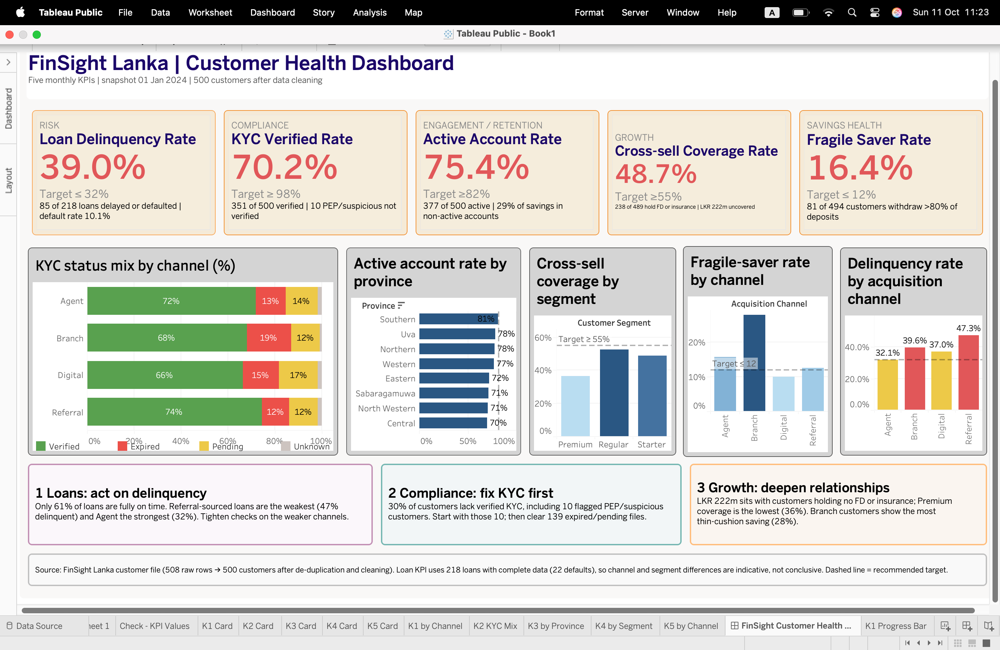

# FinSight Lanka | Customer Data Analysis

## Overview

This repository contains my workings for the FinSight Lanka customer case study. The analysis covers data cleaning, customer savings, loan risk, cross-sell opportunities and a KPI dashboard built in Tableau Public.

## What's included

| File | Description |
|---|---|
| `Workings.ipynb` | Python notebook with the full analysis |
| `Dashboard.png` | Screenshot of the Tableau KPI dashboard |

## What I did

1. **Data audit and cleaning** (508 raw rows, 500 customers after cleaning)
   - Standardised text, districts and provinces
   - Resolved duplicates using evidence (NIC birth year vs date of birth)
   - Recalculated age from date of birth
   - Set impossible balances and placeholder values to missing instead of imputing them
   - Back-tested a rule to fill missing customer segments
   - Kept missing KYC status visible as "Unknown"
   - Defined a loan-holder rule, flagged cross-column contradictions, and added validation checks plus a cleaning log
2. **Savings analysis:** savings by segment, province and age band, with robustness checks, plus cash flow and savings cushion
3. **Loan analysis:** loan penetration, debt-service ratio (DSR), default rates with confidence intervals, and sensitivity checks
4. **Cross-sell and digital engagement:** compared mobile app users with non-users, controlling for segment (within-segment comparison and a log-savings regression with robust standard errors)
5. **Cross-sell readiness and channel comparison:** readiness tiers based on compliance and account status, plus a bootstrap stability test to see which acquisition channel performs best
6. **KPI dashboard:** five monthly KPIs with targets, reconciled back to the earlier analysis

## KPI dashboard

The Tableau dashboard tracks five KPIs against targets:

| KPI | Current | Target |
|---|---|---|
| Loan Delinquency Rate | 39.0% | ≤ 32% |
| KYC Verified Rate | 70.2% | ≥ 98% |
| Active Account Rate | 75.4% | ≥ 82% |
| Cross-sell Coverage Rate | 48.7% | ≥ 55% |
| Fragile Saver Rate | 16.4% | ≤ 12% |

Loan KPIs use only the 218 loans with complete data, so channel and segment differences are indicative, not conclusive.

## Data

The dataset is confidential assessment data and is **not included** in this repository. Notebook outputs are cleared for the same reason. To reproduce the analysis, place the original dataset in a local `data/` folder and update the file path in the setup cell.

## Tools

Python (pandas, NumPy, SciPy, Matplotlib), Jupyter Notebook, Tableau Public
